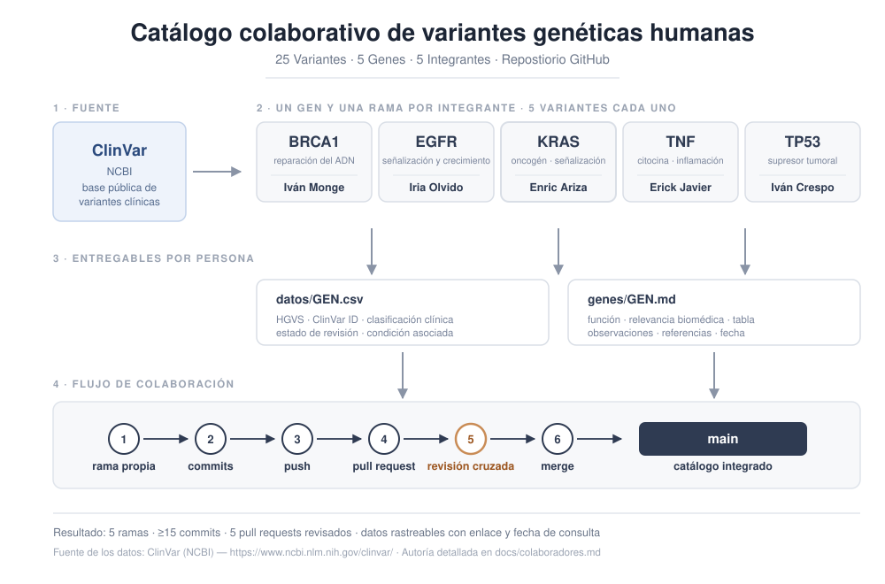

# Catálogo colaborativo de variantes genéticas humanas

## Descripción

Proyecto académico colaborativo desarrollado por cinco integrantes para documentar variantes genéticas humanas utilizando información pública de ClinVar (NCBI).

El objetivo principal fue aplicar herramientas de control de versiones y colaboración mediante Git y GitHub, integrando conocimientos básicos de genética clínica y documentación de datos biomédicos.

  

## Objetivos

- Documentar cinco variantes genéticas por cada gen seleccionado.
- Organizar información genética en archivos CSV.
- Describir la función biológica y relevancia biomédica de los genes.
- Practicar el trabajo con ramas, commits y pull requests.
- Desarrollar un repositorio organizado y documentado.

## Genes estudiados

Se seleccionaron cinco genes humanos:

| Gen | Descripción general | Integrante |
|---|---|---|
| KRAS | Participa en la señalización celular y la regulación del crecimiento y proliferación celular. | Enric Ariza Ortiz |
| EGFR | Codifica un receptor implicado en la señalización, proliferación y supervivencia celular. | Iria Olvido Moya Lopez |
| TP53 | Codifica una proteína supresora tumoral implicada en la respuesta al daño del ADN. | Ivan Crespo Morcillo |
| BRCA1 | Participa en la reparación del ADN y el mantenimiento de la estabilidad genómica. | Ivan Monge Lobo |
| TNF | Codifica una citocina relacionada con la inflamación y la regulación de procesos inmunitarios. | Erick Javier Fernandez Arguello |

Se documentaron cinco variantes por gen, para un total de 25 variantes genéticas.

## Fuente de datos

Las variantes se obtuvieron de [ClinVar (NCBI)](https://www.ncbi.nlm.nih.gov/clinvar/), una base de datos pública que recopila información sobre variantes genéticas y sus interpretaciones clínicas.

## Estructura del repositorio

- [`datos/`](datos/): archivos CSV con las variantes seleccionadas.
- [`genes/`](genes/): documentación individual de cada gen en formato Markdown.
- [`docs/`](docs/): documentación general del proyecto, metodología, conclusiones y colaboradores.

Las carpetas `datos/` y `genes/` incluyen plantillas reutilizables para facilitar futuras contribuciones.

## Metodología

Cada integrante seleccionó un gen humano y documentó cinco variantes presentes en ClinVar.

Se recopilaron datos como la nomenclatura HGVS, identificador ClinVar, clasificación clínica, estado de revisión y condición asociada, según la información disponible.

Las contribuciones se desarrollaron mediante ramas individuales y se integraron utilizando commits y pull requests.

La selección de variantes tuvo una finalidad educativa y no respondió a criterios uniformes de frecuencia poblacional, patogenicidad o relevancia clínica.

Para más información, consultar la [metodología del proyecto](docs/metodologia.md).

## Colaboración

El proyecto se desarrolló mediante Git y GitHub, permitiendo organizar las contribuciones individuales y reunir los resultados en un repositorio compartido.

Participaron cinco integrantes, cada uno responsable de la documentación de un gen.

La información del equipo se encuentra en [Colaboradores](docs/colaboradores.md).

## Resultados y conclusiones

El catálogo reúne variantes con diferentes clasificaciones clínicas, incluyendo variantes benignas, patogénicas y de significado incierto.

Los resultados permitieron reconocer la importancia de interpretar las clasificaciones de ClinVar en su contexto y considerar las limitaciones de la información disponible.

Las principales observaciones y limitaciones se presentan en las [conclusiones del proyecto](docs/conclusiones.md).

